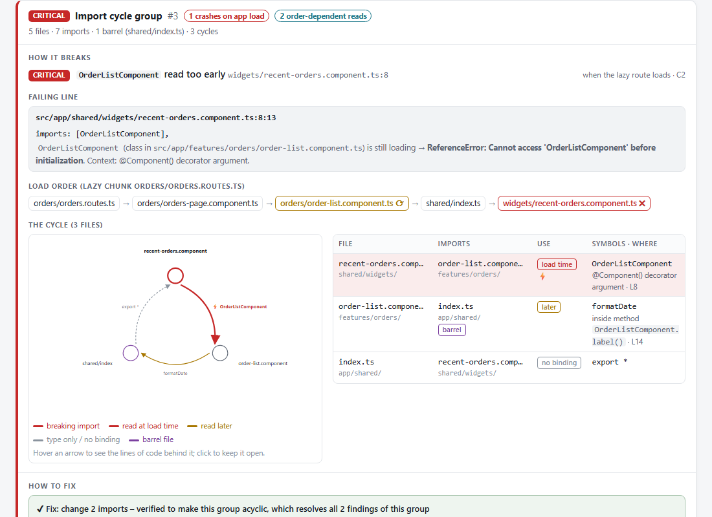
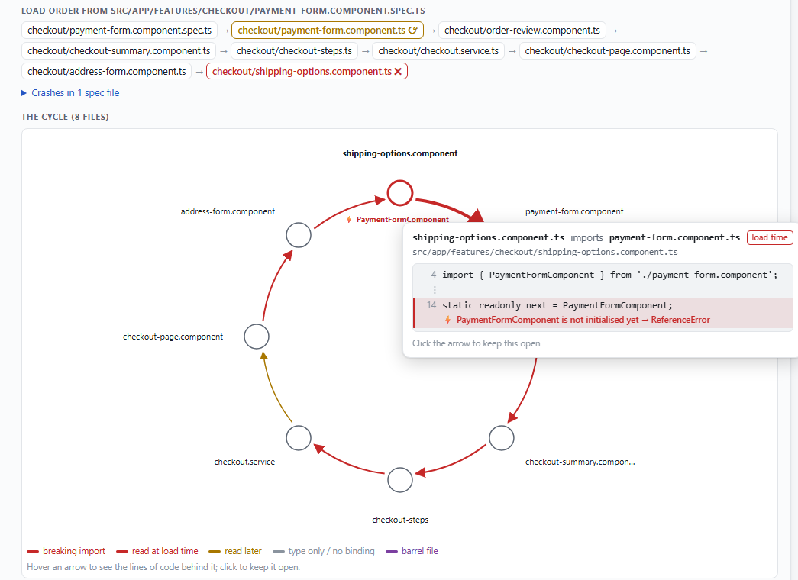
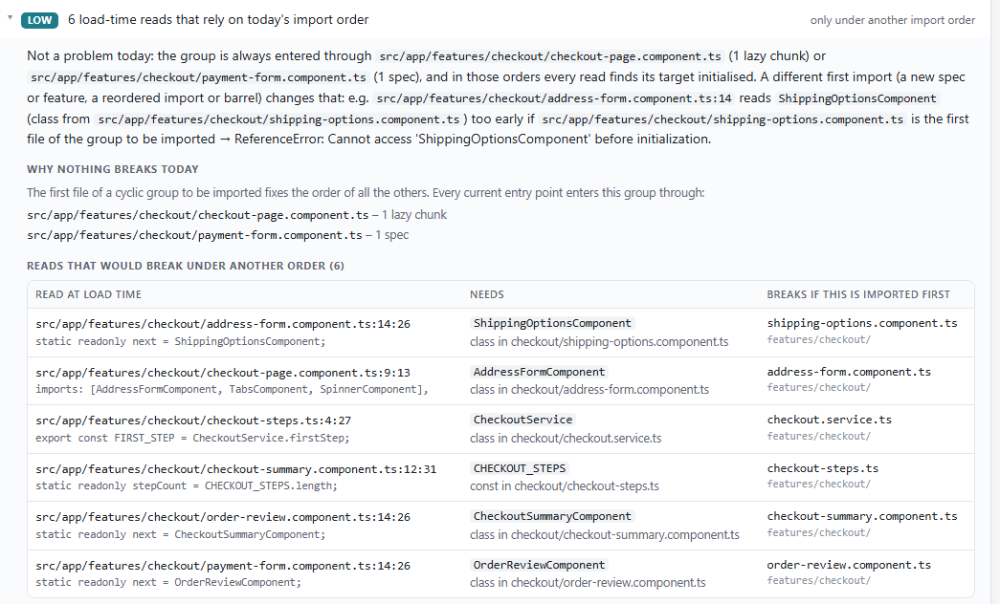

# circular-deps-check (`circdeps`)

Finds the import cycles in a TypeScript / Angular project that **actually break** – and shows the
exact line, the load order that leads to it, and a potential fix.

<p align="center">
  <a href="https://supremevoid.github.io/circular_deps_check/sample-report/"></a>
</p>

**[Check this sample report →](https://supremevoid.github.io/circular_deps_check/sample-report/)** –
the live report of a small shop app (65 components) with cycles of 2 to 8 files.

## Quick start

```bash
bun install
bun run src/cli.ts /path/to/your/project
```

Then open `reports/circular-deps.html`. The terminal prints what is broken (or may be) and one line
about the rest; `reports/` also gets a `.txt` and a `.json` version.

Without Bun at run time: `bun run build` once, then `node bin/circdeps.js /path/to/your/project`.

In CI the command exits with code 1 when something is broken (see `--fail-on`).

## What it tells you

| Severity | Meaning | What to do |
| --- | --- | --- |
| **critical** | Crashes when the app or a lazy route loads. | Fix. |
| **high** | Crashes when a spec file loads; Angular DI cycle (NG0200); a value that is silently `undefined` on app load. | Fix. |
| **medium** | *Possible* crash on a real load path: the read is reached, but it sits in a branch or callback the tool cannot prove runs. The reason is shown. | Check. |
| **low** | *Order-dependent.* Works in every load order your project uses today; would break if another file of the cycle were imported first. One entry per group of files. | Nothing now – good to know before you reorder imports there. |
| **info** | A cycle that cannot crash (the imports are only used inside functions, or only as types). | Nothing. |

Severity says how real a problem is **today**. A cycle that works in every current load order is
never more than low.

## The report

Files that can all reach each other form a *group*, and each group is one card. A card shows

1. **how it breaks** – the worst finding of the group: the failing line, the load order from your
   entry point to that line, and the cycle as a diagram;
2. **how to fix it** – the fewest imports to change, replayed (see below). One change usually fixes
   every finding of the group;
3. the other findings of the group, as rows to open.

A group in which nothing breaks today has no first part.

### The code behind every arrow

Hover an arrow of the diagram to see the import statement and the lines that use it – the failing
read is marked. Click the arrow to keep the popup open; the line numbers then open the file in VS Code.

<p align="center">
  
</p>

### What happens after the fix

Changing an import changes the order in which files load, so a line that was fine can become the
next crash. To take that surprise out, every fix is replayed: your entry points are loaded again
with the fix applied one change at a time.

```
✔ fix (verified, 2 imports):
  ✂ orders/order-list.component.ts → shared/index.ts { formatDate }  import { formatDate } from '../../shared/util/format' instead of the barrel
      then: next crash – shared/widgets/table-presets.ts:4 reads `OrderRowComponent` too early when orders.routes.ts loads – today only order-dependent, C10
  ✂ orders/order-row.component.ts → shared/index.ts { ROW_PRESET }  …
      then: C2 no longer crashes
  replayed 1 entry point with all 2 imports changed: no crash left in this group, none surfaces elsewhere
```

A "next crash" line names what would surface if you stopped after that step.

### Order-dependent cycles

A low finding lists the reads that depend on the import order, which file would have to be imported
first to break them, and why that does not happen today.

<p align="center">
  
</p>

## Options

```
circdeps [root] [options]
```

| Option | Purpose | Default |
| --- | --- | --- |
| `--entry <path\|glob>` | App entry point(s), repeatable | `src/main.ts` |
| `--test-entry <glob>` | Spec files, each loaded on its own | `**/*.spec.ts` |
| `--no-tests` | Ignore spec files | |
| `--include` / `--exclude <glob>` | Files to analyse, repeatable | all `.ts` files |
| `--tsconfig <path>` | tsconfig used for path aliases | auto-detected |
| `--out <dir>` | Where the reports go | `./reports` |
| `--display-root <text>` | Show this instead of the project path on your machine (for reports you publish or attach in CI) | |
| `--format text,html,json` | Which reports to write | all three |
| `--fail-on <severity>` | Exit 1 at this severity or worse (`none` never fails) | `high` |
| `--no-fix-preview` | Skip replaying the fixes (faster) | |
| `--verbose` / `--quiet` | Print everything / only the summary | |
| `--json` | Print the JSON report to stdout | |
| `--no-angular` | Skip the Angular DI analysis | |

Run `circdeps --help` for the full list. The same settings can live in a `circdeps.config.json`
in the project root (`entries`, `testEntries`, `include`, `exclude`, `fixPreview`, …).

## Focused questions

The full report of a large project is long. These subcommands print one small answer each – text by
default, `--json` for scripts:

| Command | Answer |
| --- | --- |
| `circdeps summary [root]` | Counts, the problem groups and their fix, a few lines each |
| `circdeps list [root]` | One line per finding; filter with `--min-severity`, `--kind`, `--file`, `--group` |
| `circdeps explain <id> [root]` | One finding: failing line, load order, the cycle with its code, fixes |
| `circdeps plan <group\|id> [root]` | The fix plan of a group and what the replay shows after every step |
| `circdeps simulate [root] --remove a.ts,b.ts` | What would crash if these imports changed – nothing is edited |
| `circdeps diff <baseline.json> [root]` | What changed since a saved JSON report; exits 1 on new problems |

`simulate` takes `--remove <from,to>` (the import is gone), `--direct <from,to>` (a barrel import
replaced by imports of the declaring files) and `--defer <from,to>` (the import stays, nothing of it
is read at load time – `forwardRef`). Files can be given by a unique path ending:

```bash
circdeps simulate --direct order-list.component.ts,src/app/shared/index.ts
```

Finding ids (`C1`, `C2` …) are positions in one run and shift after edits. Every finding also has
a `key` that stays the same; `diff` and the JSON report use it.

## For AI agents (MCP)

`circdeps mcp` starts a [Model Context Protocol](https://modelcontextprotocol.io) server over stdio
with the same questions as tools, so a coding agent can check a project, try a fix on paper and
verify its own edits. Run `bun run build` once, then register it with your agent host, for example
in `.mcp.json`:

```json
{
  "mcpServers": {
    "circdeps": {
      "command": "node",
      "args": ["/path/to/circular_deps_check/bin/circdeps.js", "mcp", "--root", "/path/to/your/project"]
    }
  }
}
```

| Tool | What the agent gets |
| --- | --- |
| `analyze` | A fresh run: counts, verdict, the problem groups and the imports to change |
| `list_findings` | One line per finding, filtered by severity, kind, file or group |
| `get_finding` | One finding: failing line, load order, the code behind every import of the cycle, fixes |
| `get_fix_plan` | The steps for a group and what replaying the entry points shows after each |
| `simulate_changes` | Before editing: what a set of import changes would resolve, and what would newly fail |
| `recheck` | After editing: findings resolved, new, and changed since the previous run or the first one |

The server only reads files – the agent makes the edits. Answers are a few kilobytes each, not the
whole report. `--entry`, `--test-entry`, `--no-tests` and `--tsconfig` work as on the command line,
and every tool accepts a `root` argument for another project.

## Use it from code

```ts
import { analyze, summarize, explainFinding, simulate } from 'circular-deps-check';

const result = await analyze({ root: '/my/app', entries: ['src/main.ts'] });
console.log(summarize(result).verdict);
console.log(explainFinding(result, 'C1').reads);
console.log(simulate(result, [{ from: 'src/a.ts', to: 'src/shared/index.ts', action: 'direct' }]).verdict);
```

## How it works

An import cycle only breaks when a file *reads* something from a file that has not finished loading.
So instead of listing cycles, the tool loads your project the way the browser or the test runner
would – on paper:

1. **Read every file** and note, for each import, whether it is used while the file loads (top-level
   code, `extends`, decorator arguments like `@Component({ imports })`, static fields), only later
   (inside functions, constructors, `inject()`), or only as a type. It follows what the compiler
   emits: type-only imports disappear, Angular constructor parameter types stay.
2. **Replay the load order** from every real starting point: `main.ts`, each lazy route on its own
   (as if a user opened that URL directly), and each spec file on its own. Every load-time read of
   something not yet initialised is a finding – with the line, the chain of files and the cycle.
   Calls into other files at load time are followed.
3. **Replay each group once more with every file imported first.** Reads that only fail there are
   the order-dependent ones (low).
4. **Find Angular DI cycles**: services and components that need each other while being constructed.
5. **Plan and replay a fix** for every group: the fewest imports to change so the group is no longer
   cyclic, then the entry points again with those changes applied.

Nothing is guessed: what cannot be proven is reported as *possible* with the reason, or not at all.

## Good to know

- Spec files are loaded one at a time with nothing else loaded, as Vitest and Jest do. Karma loads
  all specs together, where a spec that fails alone may pass. Test setup files are not replayed.
- A read inside a branch (`if`, `?:`, `&&`, `??`, after an early `return`) or in a callback of an
  array that may be empty is reported as *possible*, even if it always runs in practice.
- Callbacks handed to your own functions (`once(() => A)`), `fn.call()` and methods called on a
  fresh instance (`new Svc().get()`) are not followed, so a load-time read hidden there is missed.
- The fix replay shows the plan as written: the listed imports are gone or point at the declaring
  file. A fix that only defers a read (`forwardRef`, moving the access into a function) keeps the
  load order and helps only when that read is the failing one.
- Top-level `await import()` is treated like any lazy import. Angular `NgModule` remote scoping
  (NG3003) is not modelled.
- `simulate` and the MCP tools predict load-time reads, not Angular DI cycles, and a medium
  ("possible") finding still needs a look at the stated reason before anyone "fixes" it.

## Development

```bash
bun test              # unit and end-to-end tests, including a generated 3,000-file project
bun run typecheck
bun run build         # emits dist/ for the node CLI in bin/
bun run gen:fixtures  # regenerate fixtures/05-large-generated
```

`fixtures/` holds one small project per pattern (barrels, path aliases, lazy routes, DI cycles,
`emitDecoratorMetadata`, a fix that changes the load order) and `07-shop-app`, a shop with 65
components and every kind of finding. The screenshots and the sample report come from that app;
`bun run sample:report` rebuilds `docs/sample-report/`, which GitHub Pages serves. Detection
changes are checked against real ES-module execution; `tests/audit.test.ts` keeps the cases that
found a mistake.
